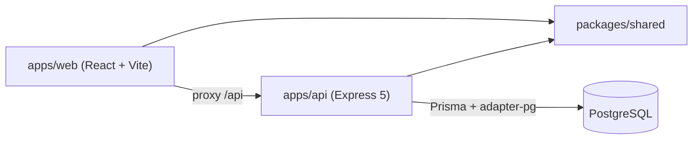
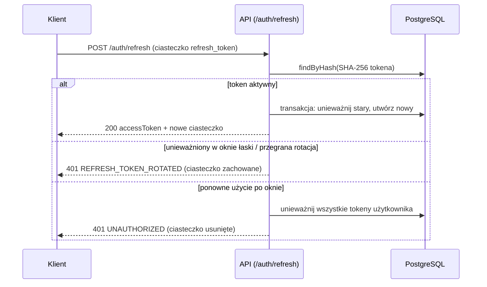

# Architektura

Stan: M1a — szkielet i uwierzytelnianie backendu. Uzasadnienia decyzji: `docs/DECISIONS.md`.

## Moduły

### packages/shared
Schematy Zod (`healthResponseSchema`, `errorResponseSchema`, uwierzytelnianie w `schemas/auth.ts`), `WS_EVENTS` (robocze), `boardRoom()`. Udostępniany przez warunek `@streamline/source` (ADR-005).

### apps/api (Controller → Service → Repository)
- `app.ts` — `createApp({ config, logger, db })` (helmet, cors, pino-http, JSON 1 MB, cookie-parser, trasy, not-found, error-handler); zależności (repozytoria, serwisy, `requireAuth`) składane ręcznie; `server.ts` — nasłuch i łagodne zamykanie.
- `config/env.ts` — walidacja Zod: `NODE_ENV`, `PORT` (4000), `DATABASE_URL`, `CORS_ORIGIN` (lista po przecinku, domyślnie `http://localhost:5173`), `LOG_LEVEL` oraz zmienne uwierzytelniania (`docs/PROJECT_STATE.md`).
- `routes/`, `controllers/`, `services/`, `repositories/` (`db.ts`, `user`, `refresh-token`), serwisy `auth`, `token` (jose, SHA-256), `password` (bcryptjs), middleware `require-auth` i `rate-limit`, `errors/app-error.ts`, `middleware/`.

### apps/web
Jedna trasa `/` (`HomePage` z przyciskiem shadcn/ui), hook `useApiHealth` walidujący odpowiedź schematem ze `shared`. Tailwind 4 (`@tailwindcss/vite`), shadcn/ui (new-york, neutral). Serwer deweloperski Vite przekazuje `/api` do API.

## Przepływy danych
Przepływ M0: `HomePage` → `useApiHealth` → `GET /api/health` (proxy Vite) → `health.routes` → `health.controller` → `health.service` → `{ "status": "ok" }`.

Przepływ odświeżania sesji (M1a):

Docelowy przepływ (ADR-003): UI → REST → baza → zdarzenie Socket.io do pokoju `board:<id>` → pozostali klienci.

## Narzędzia i CI
ESLint (jedna konfiguracja), Prettier, Husky + lint-staged, Vitest. GitHub Actions (`.github/workflows/ci.yml`): push/PR do `main` — instalacja z zamrożonym lockfile, `prisma generate`, lint, typecheck, test, format:check, build; usługa PostgreSQL.
